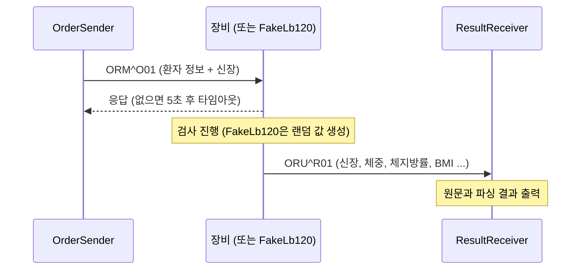
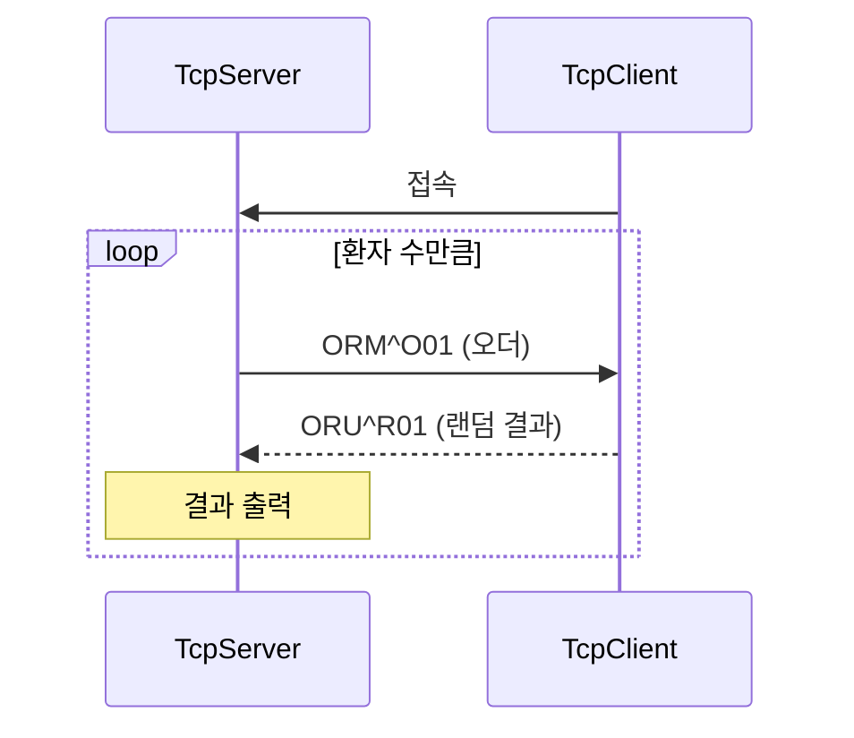

# 2026-HL7-PC

**HL7 V2 메시지를 MLLP over TCP로 주고받는 .NET 8 콘솔 프로젝트**입니다.
오더(ORM) 메시지를 보내고 검사 결과(ORU) 메시지를 받는 흐름을 단계별로 구현했고, 실제 장비 없이 시험할 수 있는 가짜 장비(FakeLb120)도 포함합니다.

---

## 목차
1. [주요 기능](#주요-기능)
2. [기술 스택](#기술-스택)
3. [솔루션 구성](#솔루션-구성)
4. [통신 방식 (MLLP)](#통신-방식-mllp)
5. [HL7 메시지 구조](#hl7-메시지-구조)
6. [메시지 흐름](#메시지-흐름)
7. [프로그램 인자](#프로그램-인자)
8. [프로젝트 구조](#프로젝트-구조)

---

## 주요 기능

| 기능 | 설명 |
| --- | --- |
| MLLP 프레이밍 | HL7 본문을 시작/종료 바이트로 감싸 TCP로 송신하고, 수신 스트림에서 프레임 단위로 복원 |
| HL7 메시지 생성 | MSH(헤더), PID(환자), OBX(측정값) 세그먼트를 만들어 한 메시지로 조립 |
| HL7 메시지 파싱 | 세그먼트 / 필드 / 컴포넌트 단위로 값을 꺼내는 파서 |
| 오더 송신 | 환자 정보와 신장을 담은 ORM^O01 메시지 전송, 응답 대기(타임아웃 5초) |
| 결과 수신 | ORU^R01 메시지를 받아 ID, 이름, 성별, 신장, 체중, 체지방률, BMI 등을 출력 |
| 장비 시뮬레이션 | 오더를 받으면 랜덤 측정값으로 결과 메시지를 만들어 돌려주는 가짜 장비 |

## 기술 스택

- **언어 / 런타임**: C#, .NET 8
- **통신**: `System.Net.Sockets` (`TcpListener`, `TcpClient`), 비동기 `async/await`
- **프로토콜**: HL7 V2.3, MLLP
- **문자 인코딩**: UTF-8

## 솔루션 구성

솔루션(`hl7-lb120.sln`)은 공통 라이브러리 1개와 실행 프로그램 5개로 이루어집니다.

| 프로젝트 | 종류 | 역할 |
| --- | --- | --- |
| `Hl7Common` | 클래스 라이브러리 | `Mllp`, `Hl7Builder`, `Hl7Parser` 공통 코드 |
| `TcpServer` | 콘솔 | 접속을 기다리다가 오더를 보내고 결과를 응답으로 받음 |
| `TcpClient` | 콘솔 | 서버에 접속해 오더를 받고 랜덤 결과를 돌려줌 |
| `OrderSender` | 콘솔 | 장비의 리스너에 접속해 오더 메시지를 송신 |
| `ResultReceiver` | 콘솔 | 장비가 보내는 검사 결과를 대기하다가 수신 |
| `FakeLb120` | 콘솔 | 장비 없이 시험하기 위한 가짜 장비 (오더 수신 → 결과 송신) |

> 개발은 `TcpServer`/`TcpClient`(TCP 기초) → HL7 오더/결과 송수신 → 장비 연동용 `OrderSender`/`ResultReceiver`/`FakeLb120` 순서로 단계별로 진행했습니다.

## 통신 방식 (MLLP)

MLLP(Minimal Lower Layer Protocol)는 HL7 메시지를 TCP로 보낼 때 메시지의 경계를 알려주는 방식입니다.

```
| 0x0B | HL7 본문 (UTF-8) | 0x1C | 0x0D |
|  SB  |                  |  EB  |  CR  |
```

- `SB`(Start Block): 프레임 시작
- `EB`(End Block) + `CR`(Carriage Return): 프레임 끝. `EB` 다음에 반드시 `CR`이 와야 완성된 프레임으로 인정하며, 아니면 오류로 처리
- 시작 바이트 이전에 들어온 데이터는 버림

## HL7 메시지 구조

세그먼트는 `\r`, 필드는 `|`, 컴포넌트는 `^`로 구분합니다.

### MSH (메시지 헤더)

| 필드 | 내용 |
| --- | --- |
| MSH-2 | 인코딩 문자 `^~\&` |
| MSH-3 ~ 6 | 송신 / 수신 애플리케이션 및 시설 |
| MSH-7 | 메시지 생성 시각 (`yyyyMMddHHmmss`) |
| MSH-9 | 메시지 타입 (`ORM^O01`: 오더, `ORU^R01`: 결과) |
| MSH-10 | 메시지 고유 식별자 |
| MSH-12 | HL7 버전 (`2.3`) |
| MSH-18 | 문자셋 (`UNICODE UTF-8`) |

### PID (환자 정보)

| 필드 | 내용 |
| --- | --- |
| PID-3 | 환자 ID |
| PID-5 | 이름 (`성^이름`) |
| PID-7 | 생년월일 (`yyyyMMdd`) |
| PID-8 | 성별 (`M` / `F`) |

### OBX (측정값 1건)

| 필드 | 내용 |
| --- | --- |
| OBX-1 | 순번 |
| OBX-2 | 값 타입 (`ST`, `NM`) |
| OBX-3 | 측정 항목 (`코드^이름`) |
| OBX-5 | 값 |
| OBX-6 | 단위 |
| OBX-11 | 결과 상태 (`F`: 최종) |

### 사용하는 측정 항목 코드

| 코드 | 항목 | 단위 |
| --- | --- | --- |
| `HT` | 신장 | cm |
| `WT` | 체중 | kg |
| `PBF` | 체지방률 | % |
| `BMI` | 체질량지수 | - |
| `DATETIMES` | 검사 일시 | `yyyyMMddHHmmss` |

## 메시지 흐름

### 장비 연동 구조



- 오더 송신과 결과 수신은 **서로 다른 연결**로 이루어집니다.
- 장비는 오더를 **리스너로 받고**, 결과는 수신 프로그램에 **새로 접속해서** 보냅니다. (결과 1건마다 접속 후 종료)

### TCP 기초 단계



## 프로그램 인자

| 프로그램 | 역할 | 인자 |
| --- | --- | --- |
| `TcpServer` | 오더 송신 / 결과 수신 | `<IP> <Port>` |
| `TcpClient` | 오더 수신 / 결과 송신 | `<서버 IP> <Port>` |
| `OrderSender` | 장비로 오더 전송 | `<장비 IP> <오더 Port>` |
| `ResultReceiver` | 장비의 결과 수신 | `<대기할 IP> <Port>` |
| `FakeLb120` | 가짜 장비 | `<오더 대기 IP> <오더 대기 Port> <결과 보낼 IP> <결과 보낼 Port>` |

## 프로젝트 구조

```
2026-HL7-PC/
├── hl7-lb120.sln
├── Hl7Common/
│   ├── Mllp.cs             MLLP 프레임 감싸기 / 읽기
│   ├── Hl7Builder.cs       MSH · PID · OBX 생성, 메시지 조립
│   └── Hl7Parser.cs        세그먼트 · 필드 · 컴포넌트 파싱
├── TcpServer/              오더 송신, 결과 수신
├── TcpClient/              오더 수신, 랜덤 결과 송신
├── OrderSender/            장비로 오더 전송
├── ResultReceiver/         장비의 결과 수신 및 출력
└── FakeLb120/              가짜 장비
```
